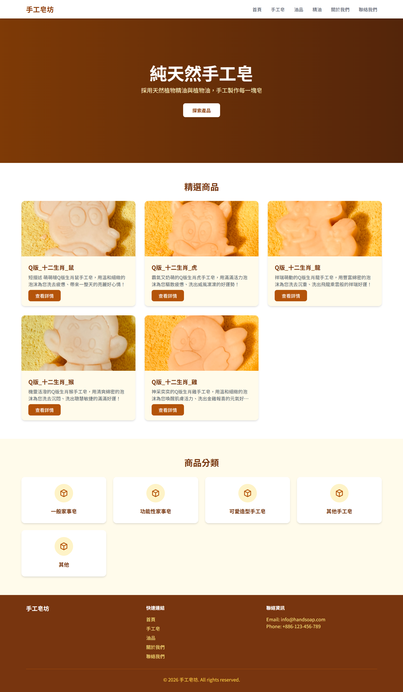
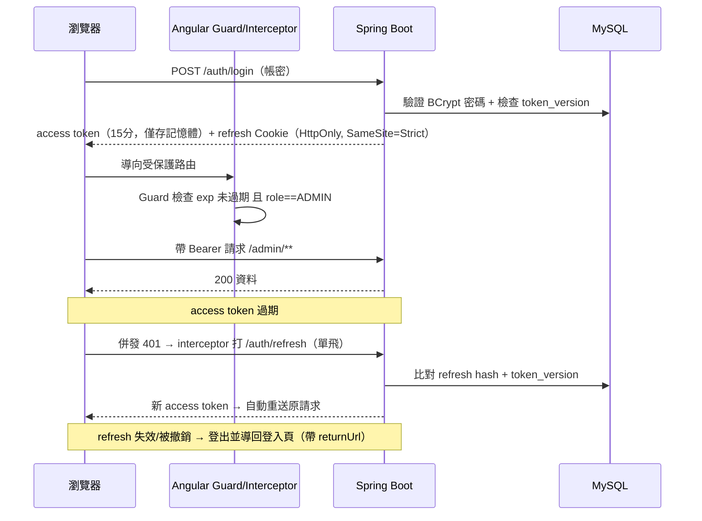

# 🧼 手工皂電商前後台系統（handSoap）

> 單一 Angular 前台 + 後台、Spring Boot RESTful API、MySQL，全站以 Docker Compose 一鍵啟動。
> 從需求到部署、從資安到可觀測性，皆為獨立設計與實作的個人作品。

一個功能完整的手工皂品牌網站：前台提供商品瀏覽／分類篩選／搜尋／聯絡表單，後台提供以 JWT
保護的數據總覽與商品（含圖片上傳）、分類、聯絡管理。全棧、容器化、含安全設計與自動化測試。

---

## 📸 畫面預覽

<!--
  TODO（作者自行補圖）：
  放 3~5 張截圖或一段 30 秒操作 GIF，效果遠勝文字。建議：
  - 前台首頁、商品列表／明細
  - 後台登入、數據總覽、商品管理（含圖片上傳）
  範例：
  
  
-->

> 尚未附圖。前台於 `http://localhost`、後台於 `http://localhost/admin/login`。

---

## 🏗️ 系統架構

```mermaid
flowchart LR
    U[瀏覽器 Browser] -->|HTTP :80| NG[Nginx 反向代理]
    subgraph handsoap-net[Docker 網路]
        NG -->|靜態資源 dist| FE[Angular 18 前台/後台]
        NG -->|/api 反代| BE[Spring Boot 後端 :8080]
        BE -->|JDBC| DB[(MySQL 8.0)]
        BK[backup 容器] -->|mysqldump 每 5 分鐘| DB
    end
    BE -. . actuator/health/readiness .-> NG
    DB -. .->|Flyway 遷移| SCHEMA[(schema 版本控管)]
```

**設計要點**：單一入口（Nginx）對外；後端與 MySQL **不對外公網暴露連接埠**，僅在容器網路內通訊；
正式版前端走同源相對路徑（`/api`、`/uploads`），由 Nginx 反代，避免 mixed content 與 CORS 麻煩。

## 🔐 認證與授權流程



## ✨ 工程亮點

- **三層 Token 策略**：access token 只放瀏覽器記憶體（防 XSS 竊取）、refresh 走 HttpOnly +
  `SameSite=Strict` Cookie、後端 `token_version` 支援**即時撤銷**（登出即讓所有裝置的未過期 token 失效）。
- **單飛 Refresh（single-flight）**：併發的 401 共用同一次 `/auth/refresh` 續杯，避免驚群與競態。
- **Guard 三重把關**：進入 admin 路由前檢查「有 token、未過期（解 JWT `exp`）、`role==='ADMIN'`」，
  並以 `returnUrl` 記住原目標頁，登入後導回；已在登入頁時不重複導向。
- **Schema 版本控管**：Flyway 管理 migration + `ddl-auto=validate` 做 Entity/DB 漂移偵測，fail-fast。
- **安全硬體化**：Nginx CSP/安全標頭與 `no-store` 快取策略、CORS fail-fast（禁 `*`）、DB 不發布對外埠、
  後端審計日誌落地、登入採**指數退避**（非硬鎖，避免把弱密碼風險換成後台永久鎖死）。
- **完整測試**：後端 39 個測試類（Controller/Service/Security/例外）+ 前端 354 個 spec。
- **CI/CD**：GitHub Actions 平行跑 backend（`mvn verify`）／frontend（Karma + production build）、
  compose 煙霧測試、secrets 掃描、OSV 依賴掃描；Dependabot 每週升級 npm/maven。
- **自我 Code Review 閉環**：從 Critical→Low 逐項審查與修正，並記錄每項取捨——見
  [`docs/review/`](docs/review/2026-09-29-full-code-review.md)。

## 🛠️ 技術棧

| 層級 | 技術 |
| --- | --- |
| 前端 | Angular 18（Standalone）+ Tailwind CSS |
| 後端 | Spring Boot 3.4 + Spring Security + JWT (jjwt) + JPA |
| 資料庫 | MySQL 8.0 + Flyway |
| 反向代理 | Nginx（安全標頭、反代、靜態服務） |
| 容器 | Docker Compose（含健康探針、自動重啟、定期備份） |
| 測試 | JUnit/MockMvc（後端）、Jasmine/Karma（前端） |

## 🚀 快速啟動（30 秒）

```bash
# 1) 環境變數
cp .env.example .env          # 至少改 DB_ROOT_PASS / DB_USER / DB_PASS / JWT_SECRET

# 2) 建置前端產物（nginx 需要 dist）
cd frontend && npm install && npm run build && cd ..

# 3) 啟動全部服務
docker compose up --build
```

> 本機開發若要用 GUI 工具連 MySQL，改帶 `-f docker-compose.dev.yml`（埠只綁 `127.0.0.1:3307`）。

### ✅ 起完後 30 秒驗證全站活著

```bash
docker compose ps                                   # nginx/backend/mysql/backup 應為 running / healthy
curl -s http://localhost/actuator/health/readiness  # backend readiness，含 DB 檢查
# 開瀏覽器：http://localhost            （前台）
#           http://localhost/admin/login （後台，需先建立管理員，見下）
```

首次需建立後台管理員（安全設計，不開放匿名建號）：

```bash
# .env 設 BOOTSTRAP_ENABLED=true + BOOTSTRAP_ADMIN_USERNAME/PASSWORD/EMAIL 後：
docker compose up -d backend
docker compose logs -f backend   # 看到「[bootstrap] 已建立首位管理員」即完成
# 完成後請立即登入改密碼，並把 BOOTSTRAP_ENABLED 改回 false
```

### ⚠️ 常見問題

- **前台是舊版／樣式錯亂**：前端改了但沒重新 `npm run build`，nginx 吃到舊 `dist`。
- **backend 起不來（`Could not resolve placeholder 'DATABASE_PASSWORD'`）**：`.env` 缺少必要值。
- **登入顯示「請重新登入」卻進不去**：檢查 `.env` 的 `JWT_SECRET` 是否與啟動時一致（改動會讓舊 token 失效）。
- 其餘部署／備份／還原／TLS 細節請見 **[維運手冊 OPERATIONS.md](OPERATIONS.md)**。

## 🧭 功能導覽

**前台**

| 路徑 | 說明 |
| --- | --- |
| `/` | 首頁（Banner、最新商品、分類快速連結） |
| `/soaps` | 手工皂列表（分類篩選、搜尋、排序） |
| `/soaps/:id` | 手工皂明細 |
| `/oils` | 油品列表 |
| `/oils/:id` | 油品明細 |
| `/essential-oils` | 精油列表 |
| `/essential-oils/:id` | 精油明細 |
| `/about` | 關於我們 |
| `/contact` | 聯絡我們 |

**後台**（需 JWT + ADMIN）

| 路徑 | 說明 |
| --- | --- |
| `/admin/login` | 後台登入 |
| `/admin/dashboard` | 數據總覽 |
| `/admin/categories` | 分類管理（新增/編輯/刪除） |
| `/admin/soaps` | 手工皂管理（含圖片上傳） |
| `/admin/oils` | 油品管理（含圖片上傳） |
| `/admin/essential-oils` | 精油管理（含圖片上傳） |
| `/admin/contacts` | 聯絡表單管理 |

## 📡 API 概覽

**前台（公開）**

```
GET  /api/v1/categories
GET  /api/v1/soaps                # 支援 keyword、categoryId、分頁/排序
GET  /api/v1/soaps/{id}
GET  /api/v1/soaps/featured
GET  /api/v1/oils
GET  /api/v1/essential-oils
POST /api/v1/contacts
```

**後台（需 ADMIN JWT）**

```
POST   /api/v1/auth/login
GET    /api/v1/admin/categories          POST/PUT/DELETE /categories/{id}
GET    /api/v1/admin/soaps?keyword=      POST/PUT/DELETE /soaps/{id}  + /soaps/{id}/images
GET    /api/v1/admin/oils                POST/PUT/DELETE /oils/{id}
GET    /api/v1/admin/essential-oils      POST/PUT/DELETE /essential-oils/{id}
GET    /api/v1/admin/contacts            PUT /contacts/{id}
```

## 📁 專案結構

```
handSoap/
├── docker-compose.yml          # 編排：nginx + backend + mysql + backup（含健康探針/重啟）
├── docker-compose.dev.yml      # 本機開發覆寫：MySQL 僅綁 127.0.0.1:3307
├── nginx/nginx.conf            # 反向代理 + 安全標頭 + 靜態服務
├── mysql/init/                 # Flyway schema 遷移 + 種子資料
├── backend/                    # Spring Boot（config/controller/service/repository/entity/dto）
├── frontend/                   # Angular（front 前台 / admin 後台 / shared 共用）
├── OPERATIONS.md               # 維運手冊（部署/開發/DB/備份還原/TLS/安全）
├── docs/
│   └── review/                 # 程式碼審查記錄與修正（本機保留，未進版控）
└── .github/
    ├── workflows/ci.yml        # CI：測試 + build + compose 煙霧 + 掃描
    └── dependabot.yml          # 每週自動升級 npm/maven
```

## 📚 延伸閱讀

- [維運手冊 OPERATIONS.md](OPERATIONS.md) — 部署、本機開發、資料庫連線、備份還原演練、TLS 上線、secrets 掃描
- [程式碼審查記錄](docs/review/2026-09-29-full-code-review.md) — 從 Critical 到 Low 的問題盤點與修正決策

---

<sub>授權：本專案為個人作品集用途。</sub>

